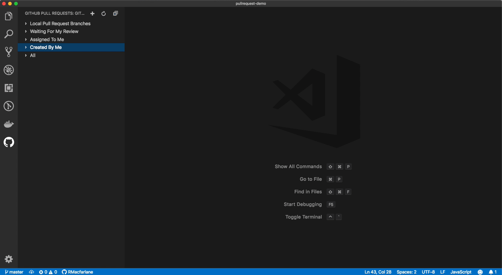
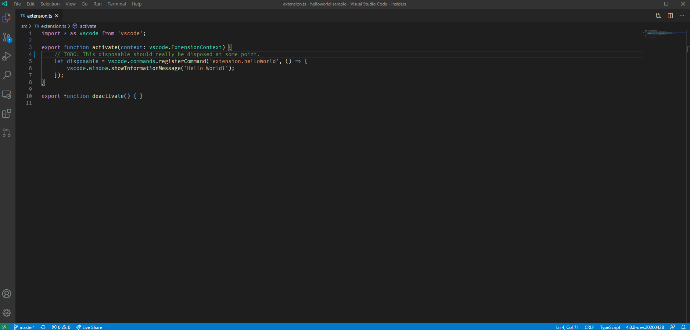

# Azure DevOps Pull Requests & Work Items

This standalone fork is being rebuilt from the original GitHub Pull Requests application.
The goal is to retain its existing tree, React overview, creation form, diff viewers,
comment controllers, and review workflows, replacing repository operations with an Azure
DevOps provider rather than building a separate Azure interface.

## Restart status

The `feat/azure-provider-shared-ui` branch starts from upstream commit `b7b9342b`.
The previous implementation, including the unfinished overview experiment, is preserved
on `backup/azure-parallel-ui-20261019` at `ccf1fe3a`. No history was rewritten.

This branch is a **development foundation, not an Azure-ready release**:

- The original UI and workflow controllers are retained.
- Extension-owned commands, settings, views, chat tools, and document schemes have
  independent identifiers. The extension ID remains `jhare96.vscode-pull-request-azdo`.
- The tested Azure authentication, REST transport, trusted remote parsing, and persistent
  pending-review implementation have been carried across.
- A typed [provider contract](src/providers/pullRequestProvider.ts) and
  [Azure implementation](src/azure/pullRequestProvider.ts) expose existing application
  models, not HTML or GitHub REST/GraphQL emulation.
- The Azure provider covers PR loading/creation/editing, discussion ownership, reviews,
  policies, and source-commit-checked completion. Unsupported capabilities are explicit.

**The existing controllers have not yet been switched to the Azure provider.** F5 builds
and launches the restored application, which still uses its original GitHub backend.
Do not use this branch to test Azure sign-in or expect Azure PR browsing yet.
The old native Azure implementation is available on the recovery branch.

The next integration step is to route the existing repository/model controllers through
the provider contract, then validate browsing, overview, diffs/comments, reviews,
creation, and completion against Azure. Provider-specific features must be gated in the
existing components; a second overview, tree, or creation UI must not be introduced.

## Development

- F5 runs `npm run compile` before launching.
- `npm run compile` builds the desktop, browser, and original React webview bundles.
- `npm run compile:test` type-checks and emits extension-host tests.
- `npm run test:webviews` runs the original shared UI regression suite.
- `npm run check:commands`, `npm run lint`, and `npm run hygiene` validate contributions
  and repository conventions.

The original project documentation below is retained as **upstream reference**. Its
GitHub setup instructions describe the current upstream backend, not completed Azure
functionality.

---

## Upstream documentation

> Review and manage your GitHub pull requests and issues directly in VS Code

This extension allows you to review and manage GitHub pull requests and issues in Visual Studio Code. The support includes:

- Authenticating and connecting VS Code to GitHub and GitHub Enterprise.
- Listing and browsing PRs from within VS Code.
- Reviewing PRs from within VS Code with in-editor commenting.
- Validating PRs from within VS Code with easy checkouts.
- Terminal integration that enables UI and CLIs to co-exist.
- Listing and browsing issues from within VS Code.
- Hover cards for "@" mentioned users and for issues.
- Completion suggestions for users and issues.
- A "Start working on issue" action which can create a branch for you.
- Code actions to create issues from "todo" comments.





# Getting Started

It's easy to get started with GitHub Pull Requests for Visual Studio Code. Simply follow these steps to get started.

1. Install the extension from within VS Code or download it from [the marketplace](https://aka.ms/vscodepr-download).
1. Open your desired GitHub repository in VS Code.
1. A new viewlet will appear on the activity bar which shows a list of pull requests and issues.
1. Use the button on the viewlet to sign in to GitHub.
1. You may need to configure the `githubPullRequests.remotes` setting, by default the extension will look for PRs for `origin` and `upstream`. If you have different remotes, add them to the remotes list.
1. You should be good to go!

Check out https://www.youtube.com/watch?v=LdSwWxVzUpo for additional getting started tips!

# Configuring the extension

There are several settings that can be used to configure the extension.

## GitHub Enterprise

VS Code 1.141 or later is required. If you use Insiders, keep it updated to the latest build.

Configure GHE.com and GitHub Enterprise Server instances using the built-in GitHub Authentication setting:

```json
{
	"github-enterprise.uris": [
		"https://company.ghe.com",
		"https://github.example.com"
	]
}
```

The list order does not select a default instance. An explicitly configured list takes precedence over the deprecated `github-enterprise.uri` setting, including an empty list (`[]`), which disables Enterprise instances. If the list is not configured, the legacy setting still applies. Workspace and folder instance settings only apply in trusted workspaces.

GitHub Pull Requests uses **one selected Enterprise account at a time**, alongside a separate GitHub.com account. When another instance is needed or no account is selected, use **Select Account** in the Pull Requests or Login view. This opens account preferences for this extension and GitHub Enterprise directly, or starts sign-in if you have no Enterprise accounts yet. You can also run **GitHub Pull Requests: Select GitHub Enterprise Account...** or use **Accounts > Manage Extension Account Preferences...**. To add another instance, edit `github-enterprise.uris` in Settings; ordinary sign-in does not replace your existing list.

Removing an instance from the list does not delete its saved sign-ins. GitHub.com accounts do not need either Enterprise setting.

## Remotes and queries

As mentioned above, `githubPullRequests.remotes` is used to specify what remotes the extension should try to fetch pull requests from.

To customize the pull request tree, you can use the `githubPullRequests.queries` setting. This setting is a list of labels and search queries which populate the categories of the tree. By default, these queries are "Waiting For My Review", "Assigned To Me", and "Created By Me". An example of adding a "Mentioned Me" category is to change the setting to the following:

```
"githubPullRequests.queries": [
	{
		"label": "Waiting For My Review",
		"query": "is:open review-requested:${user}"
	},
	{
		"label": "Assigned To Me",
		"query": "is:open assignee:${user}"
	},
	{
		"label": "Created By Me",
		"query": "is:open author:${user}"
	},
	{
		"label": "Mentioned Me",
		"query": "is:open mentions:${user}"
	}
]
```

Similarly, there is a setting to configure your issues queries: `githubIssues.queries`.

Queries use [GitHub search syntax](https://help.github.com/en/articles/understanding-the-search-syntax).

To view additional settings for the extension, you can open VS Code settings and search for "github pull requests".

# Issues

This extension is still in development, so please refer to our [issue tracker for known issues](https://github.com/Microsoft/vscode-pull-request-github/issues), and please contribute with additional information if you encounter an issue yourself.

## Questions? Authentication? GitHub Enterprise?

See our [wiki](https://github.com/Microsoft/vscode-pull-request-github/wiki) for our FAQ.

## Contributing

If you're interested in contributing, or want to explore the source code of this extension yourself, see our [contributing guide](https://github.com/Microsoft/vscode-pull-request-github/wiki/Contributing), which includes:

- [How to Build and Run](https://github.com/Microsoft/vscode-pull-request-github/wiki/Contributing#build-and-run)
- [Architecture](https://github.com/Microsoft/vscode-pull-request-github/wiki/Contributing#architecture)
- [Making Pull Requests](https://github.com/Microsoft/vscode-pull-request-github/wiki/Contributing#pull-requests)
- [Code of Conduct](https://github.com/Microsoft/vscode-pull-request-github/wiki/Contributing#code-of-conduct)
